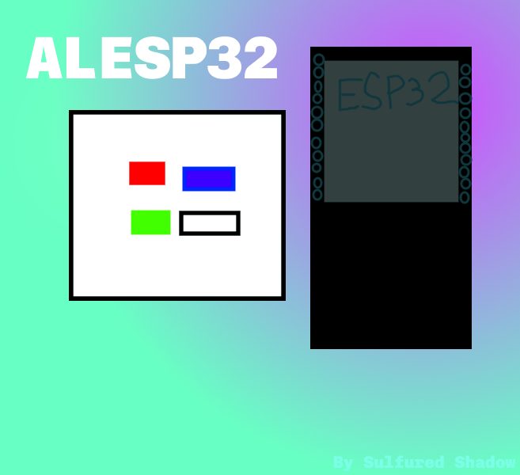
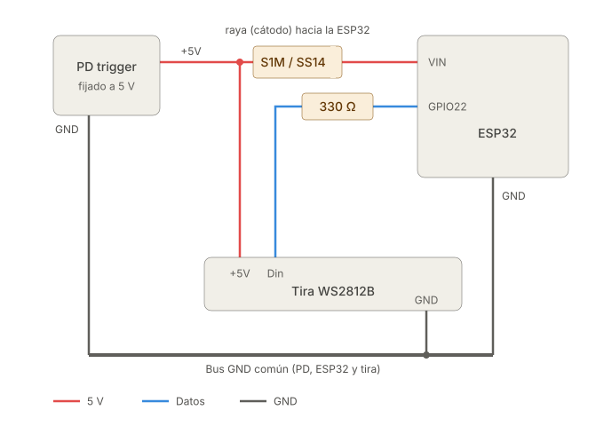

# ALESP32

> Dont mind mi drawing skills, it's still a work-in-progress...

>[!NOTE]
> This project is not exactly ideal for a final product, no if anything doesn't work as intented or expected please let me know.

## Instalation

>To install such project you'll need couple things first
----
---
### 1 Components
---

1. ESP32 (Almost any ESP32 will work)
2. USB type C PD trigger (It's a board that makes a handshake with any PD C charger to output the needed 5v)
3. Diode (Something like an S1M or 1N4007 will work)
4. 330 Ohm resistor (between Data pin and ESP32)
4. USB C PD charger
5. LED's (WS2812B or similar)
---
---
---
### 2 Schematics

----

